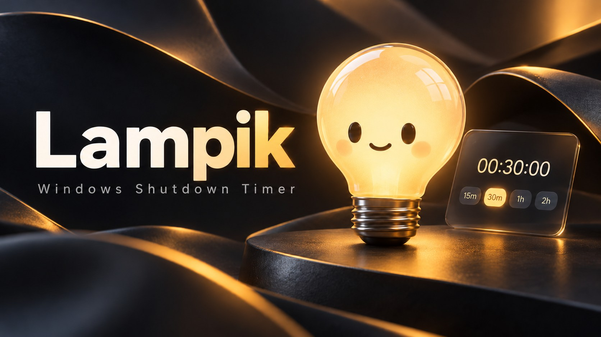

# Lampik — Windows Shutdown Timer

**Лампик** — маленький помощник для Windows, который выключает компьютер по таймеру. Вместо громоздких меню — светящаяся лампочка, одно поле ввода и горячие клавиши.

*Set a shutdown timer in seconds. A glowing desktop companion for Windows, built with C# and WPF.*

*Обложка — иллюстрация проекта, созданная с помощью генерации изображений, а не скриншот интерфейса.*

**v0.7.0-beta.1 · Windows 10/11 x64 · WPF / .NET 8**

- Единственное главное окно — компактная тёмная glass-карточка 310 × 248 DIP; с таймером — 303 DIP и крупная кнопка отмены.
- Быстрые кнопки 15 мин / 30 мин / 1 час / 2 часа без ввода команды.
- Pet Mode — только анимированная лампочка на прозрачной поверхности поверх окон. Пустая область пропускает клики на рабочий стол через нативную маску Windows.
- Перетаскивай питомца; позиция сохраняется. Клик открывает карточку, правый клик — меню открытия, отмены, настроек и выхода.
- `Ctrl+Alt+L` переключает Card ↔ Pet; `Esc` сворачивает карточку в питомца; `Ctrl+Alt+X` отменяет таймер.
- RU/EN, настройка темы, автозапуск, собственная иконка, команды выключения/перезагрузки/сна/гибернации.
- За минуту до действия — окно с отменой и +10 минут. После перезапуска восстановление требует явной команды. Просроченное действие не выполняется после позднего пробуждения.
- Привязка к краям опциональна по ТЗ и в этой бете не включена.

## Два языка / Two languages

Лампик поддерживает **Русский** и **English**. Первый язык выбирается по языку Windows; его можно изменить в **Настройки → Язык / Settings → Language**. Выбор сохраняется в локальных настройках и действует для всего интерфейса, сообщений, системного трея и установщика. **Команды на обоих языках понимаются независимо от языка интерфейса.**

Lampik supports **Russian and English**. The initial language follows your Windows locale. Switch it in **Settings → Language**; your preference persists across restarts. Both languages work for text commands regardless of the selected UI language.

| Русская команда | English command | Что произойдёт / Result |
| --- | --- | --- |
| `выключи через 30 минут` | `shut down in 30 minutes` | Shutdown in 30 minutes |
| `сон через час` | `sleep in an hour` | Sleep in 1 hour |
| `перезагрузи в 23:00` | `restart at 11 pm` | Restart at 23:00 |
| `гибернация через полчаса` | `hibernate in half an hour` | Hibernate in 30 minutes |
| `отмени` | `cancel` | Cancel active timer |

## Примеры команд

| Ввод | Результат |
| --- | --- |
| `выключи через 40 минут` | Выключение через 40 минут |
| `перезагрузи в 23:00` | Перезагрузка в 23:00 |
| `сон через час` | Сон через 60 минут |
| `гибернация через 20 минут` | Гибернация через 20 минут |
| `отмени` | Отмена текущего таймера |
| `статус` | Сколько осталось до действия |
| `помощь` | Подсказка по командам |

## Горячие клавиши

В стартовом наборе:

| Сочетание | Действие |
| --- | --- |
| `Ctrl+Alt+1` | Выключение через 1 минуту |
| `Ctrl+Alt+3` | Выключение через 30 минут |
| `Ctrl+Alt+6`, затем `Ctrl+Alt+0` | Выключение через 60 минут |
| `Ctrl+Alt+L` | Переключить Card ↔ Pet |
| `Ctrl+Alt+X` | Отменить таймер |

В настройках можно задать, например, `Ctrl+1` и последовательность `Ctrl+6, Ctrl+0`. Вторая запись означает **два последовательных сочетания**, а не три одновременно удерживаемые клавиши. Простые сочетания могут конфликтовать с другими программами, поэтому стандартные используют Alt.

## Установка и запуск / Installation

**Платформа / Platform:** Windows 10/11, x64 · C# · WPF · .NET 8.

Предрелизы и установочные файлы доступны в [Releases](https://github.com/davins526/lampik-shutdown-timer/releases). Проверяйте успешный статус соответствующей Windows-сборки в [Actions](https://github.com/davins526/lampik-shutdown-timer/actions).

Для запуска из исходников установите [.NET 8 SDK](https://dotnet.microsoft.com/download/dotnet/8.0) и выполните:

```powershell
dotnet run --project Lampik/Lampik.csproj -c Release
```

Для автономной сборки:

```powershell
dotnet publish Lampik/Lampik.csproj -c Release -r win-x64 --self-contained true -p:PublishSingleFile=true -p:IncludeNativeLibrariesForSelfExtract=true -o release
```

Установщик создаётся по сценарию `installer/Lampik.iss` через [Inno Setup 6](https://jrsoftware.org/isdl.php).

## Исходники и проверки

`Lampik/Program.cs` — карточка, парсер и управление таймером; `Lampik/PetWindow.cs` — прозрачный питомец и нативная область ввода; `Lampik/LampikMascot.cs` — векторная анимация. `tests/Lampik.ParserTests` проверяет команды, безопасность, WPF-окна и маску питомца.

```powershell
dotnet run --project tests/Lampik.ParserTests -c Release
```

Настройки сохраняются локально в `%LOCALAPPDATA%\Lampik\settings.json`.

## Безопасность и ограничения

Лампик вызывает стандартные механизмы управления питанием Windows. Принудительное закрытие других приложений через `shutdown /f` не используется, но **несохранённые данные всё равно могут оказаться под угрозой**. Перед тестами сохраняйте работу. По умолчанию доступна отмена по `Ctrl+Alt+X`, а за минуту до срабатывания предусмотрено предупреждение.

Таймер работает, **пока запущен сам Лампик и компьютер не спит**. Это не системная служба; команды могут не выполниться, если Windows завершит процесс. Программа не требует подключения к интернету для обычной работы.

## Дизайн / Visual design

Версия 0.4.1 заменяет стандартные прямоугольные элементы WPF фирменными округлыми контролами. Главное окно использует тёмно-синие градиенты, мягкие тени, тёплые акценты и собственную иконку. Настройки отделены на карточки с сегментированным выбором языка и переключателями. Всё реализовано на C# / WPF без веб-движка.

The glass effect is visual and self-contained; it does not rely on Windows Acrylic/DWM composition or an internet connection. UI scaling and display behavior still need manual verification on Windows 10/11.

## Быстрое управление / Quick popup

1. Убедись, что Лампик запущен (может быть скрыт в системном трее).
2. Нажми `Ctrl+Alt+L`: всплывёт компактное окно сбоку или в последнем сохранённом положении.
3. Введи `выключи через 40 минут` или `shut down in 40 minutes` и нажми Enter.
4. После установки таймера окно автоматически скроется, отсчёт продолжится в трее.

Use `Esc` to hide the widget without setting a timer. You can drag the window to your preferred corner or edge.

## Что дальше

- [ ] Проверить сборку и поведение на Windows 10/11
- [ ] Опубликовать первый установщик
- [ ] Добавить скриншоты и короткую демонстрацию
- [x] Добавить живую лампочку с эмоциями и мини-виджет с чатом
- [ ] Проверить анимации и мини-режим вручную на Windows 10/11
- [ ] Добавить автозапуск и восстановление запланированного таймера

---

**Lampik** — маленький светящийся помощник, который вовремя отправит компьютер отдыхать.

*Проект находится на стадии MVP; условия лицензирования пока не опубликованы.*
