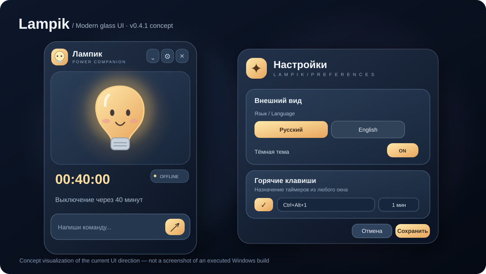

# Lampik — Windows Shutdown Timer

**Лампик** — маленький помощник для Windows, который выключает компьютер по таймеру. Вместо громоздких меню — светящаяся лампочка, одно поле ввода и горячие клавиши.

*Set a shutdown timer in seconds. A glowing desktop companion for Windows, built with C# and WPF.*



*Иллюстрация — макет интерфейса, не скриншот запущенного приложения.*

> **Статус: MVP 0.3 / разработка.** Проект пока не прошёл полноценную проверку сборки и запуска на Windows. Пожалуйста, сохраняйте документы перед тестированием команд питания.

## Зачем Лампик?

Написал **«выключи через 40 минут»**, свернул окно — и занимаешься своими делами. Лампик остаётся в системном трее и показывает оставшееся время.

- **Компактное окно** 300 × 324 px и мини-режим 300 × 160 px; можно разместить сбоку или внизу экрана.
- **Тёмный интерфейс и живая лампочка:** мягкий ореол, моргание и анимация ожидания.
- **Локальные текстовые команды** на русском — без облака, регистрации, ИИ и интернета.
- **Таймеры питания:** выключение, перезагрузка, сон и гибернация.
- **Глобальные горячие клавиши:** свои сочетания для запуска таймеров, в том числе двухшаговые.
- **Фоновая работа в трее**, обратный отсчёт и отмена активного таймера.
- **Светлая тема**, настройка режима «поверх окон» и сохранение параметров.

## Два языка / Two languages

Лампик поддерживает **Русский** и **English**. Первый язык выбирается по языку Windows; его можно изменить в **Настройки → Язык / Settings → Language**. Выбор сохраняется в локальных настройках и действует для всего интерфейса, сообщений, системного трея и установщика. **Команды на обоих языках понимаются независимо от языка интерфейса.**

Lampik supports **Russian and English**. The initial language follows your Windows locale. Switch it in **Settings → Language**; your preference persists across restarts. Both languages work for text commands regardless of the selected UI language.

| Русская команда | English command | Что произойдёт / Result |
| --- | --- | --- |
| `выключи через 30 минут` | `shut down in 30 minutes` | Shutdown in 30 minutes |
| `сон через час` | `sleep in an hour` | Sleep in 1 hour |
| `перезагрузи в 23:00` | `restart at 11 pm` | Restart at 23:00 |
| `гибернация через полчаса` | `hibernate in half an hour` | Hibernate in 30 minutes |
| `отмени` | `cancel` | Cancel active timer |

## Примеры команд

| Ввод | Результат |
| --- | --- |
| `выключи через 40 минут` | Выключение через 40 минут |
| `перезагрузи в 23:00` | Перезагрузка в 23:00 |
| `сон через час` | Сон через 60 минут |
| `гибернация через 20 минут` | Гибернация через 20 минут |
| `отмени` | Отмена текущего таймера |
| `статус` | Сколько осталось до действия |
| `помощь` | Подсказка по командам |

## Горячие клавиши

В стартовом наборе:

| Сочетание | Действие |
| --- | --- |
| `Ctrl+Alt+1` | Выключение через 1 минуту |
| `Ctrl+Alt+3` | Выключение через 30 минут |
| `Ctrl+Alt+6`, затем `Ctrl+Alt+0` | Выключение через 60 минут |
| `Ctrl+Alt+L` | Показать / скрыть окно |
| `Ctrl+Alt+X` | Отменить таймер |

В настройках можно задать, например, `Ctrl+1` и последовательность `Ctrl+6, Ctrl+0`. Вторая запись означает **два последовательных сочетания**, а не три одновременно удерживаемые клавиши. Простые сочетания могут конфликтовать с другими программами, поэтому стандартные используют Alt.

## Установка и запуск / Installation

**Платформа / Platform:** Windows 10/11, x64 · C# · WPF · .NET 8.

Когда будет доступна успешная Windows-сборка, автономный EXE и установщик будут опубликованы в разделе [Actions](../../actions) → **Windows EXE and installer** → *Artifacts*. Пока не считайте релиз готовым без успешной сборки.

Для запуска из исходников установите [.NET 8 SDK](https://dotnet.microsoft.com/download/dotnet/8.0) и выполните:

```powershell
dotnet run --project Lampik/Lampik.csproj -c Release
```

Для автономной сборки:

```powershell
dotnet publish Lampik/Lampik.csproj -c Release -r win-x64 --self-contained true -p:PublishSingleFile=true -p:IncludeNativeLibrariesForSelfExtract=true -o release
```

Установщик создаётся по сценарию `installer/Lampik.iss` через [Inno Setup 6](https://jrsoftware.org/isdl.php).

> **Примечание:** репозиторий сейчас оформляется. Исходники и workflow будут добавлены отдельно. Описанные функции относятся к подготовленному MVP, а не к опубликованному и проверенному релизу.

## Как устроен проект

```text
Lampik/                  # Windows-приложение WPF
  MainWindow.xaml        # Компактный интерфейс и персонаж
  PowerCommandParser.cs  # Локальный разбор команд
  HotkeySyntax.cs        # Синтаксис сочетаний
  AppPreferences.cs      # Сохранение настроек
  SettingsWindow.xaml    # Настройки
tests/ParserSmokeTests/  # Проверки парсера и горячих клавиш
installer/Lampik.iss     # Сценарий установщика
.github/workflows/       # Автоматическая Windows-сборка
```

Настройки сохраняются локально в `%LOCALAPPDATA%\Lampik\settings.json`.

## Безопасность и ограничения

Лампик вызывает стандартные механизмы управления питанием Windows. Принудительное закрытие других приложений через `shutdown /f` не используется, но **несохранённые данные всё равно могут оказаться под угрозой**. Перед тестами сохраняйте работу. По умолчанию доступна отмена по `Ctrl+Alt+X`, а за минуту до срабатывания предусмотрено предупреждение.

Таймер работает, **пока запущен сам Лампик и компьютер не спит**. Это не системная служба; команды могут не выполниться, если Windows завершит процесс. Программа не требует подключения к интернету для обычной работы.

## Что дальше

- [ ] Проверить сборку и поведение на Windows 10/11
- [ ] Опубликовать первый установщик
- [ ] Добавить скриншоты и короткую демонстрацию
- [ ] Доработать анимации, звук и режим мини-виджета
- [ ] Добавить автозапуск и восстановление запланированного таймера

---

**Lampik** — маленький светящийся помощник, который вовремя отправит компьютер отдыхать.

*Проект находится на стадии MVP; условия лицензирования пока не опубликованы.*
